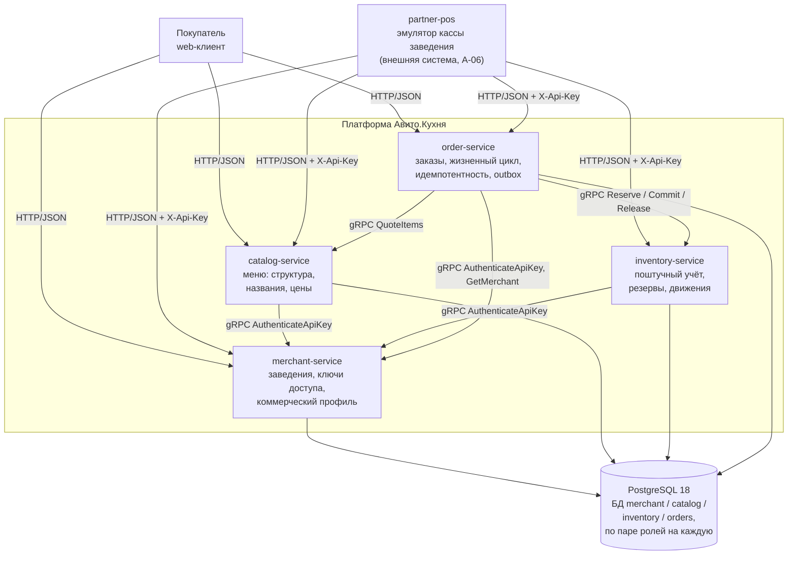
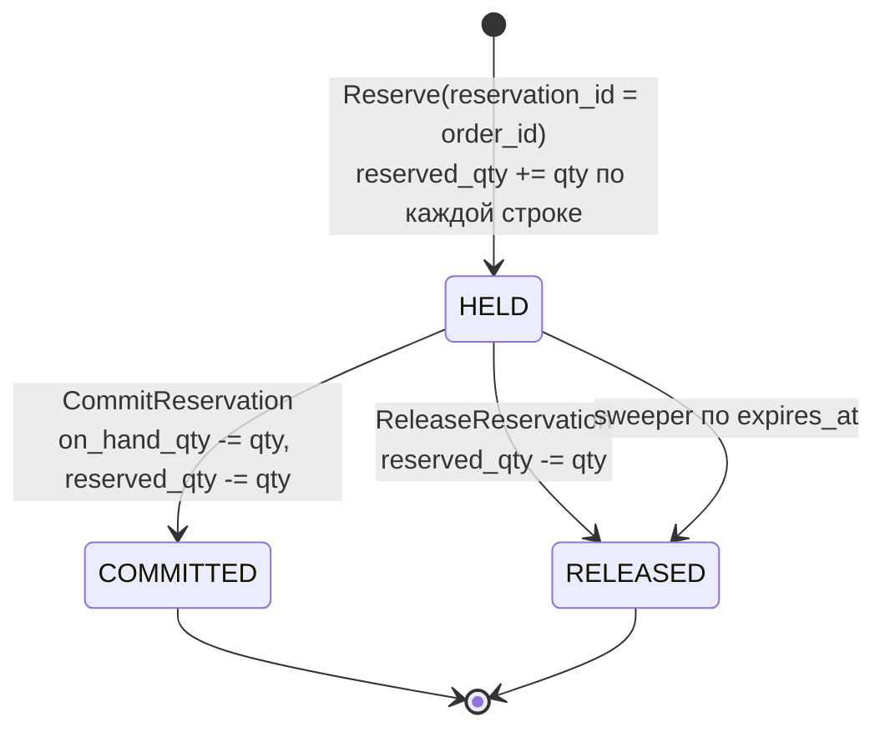
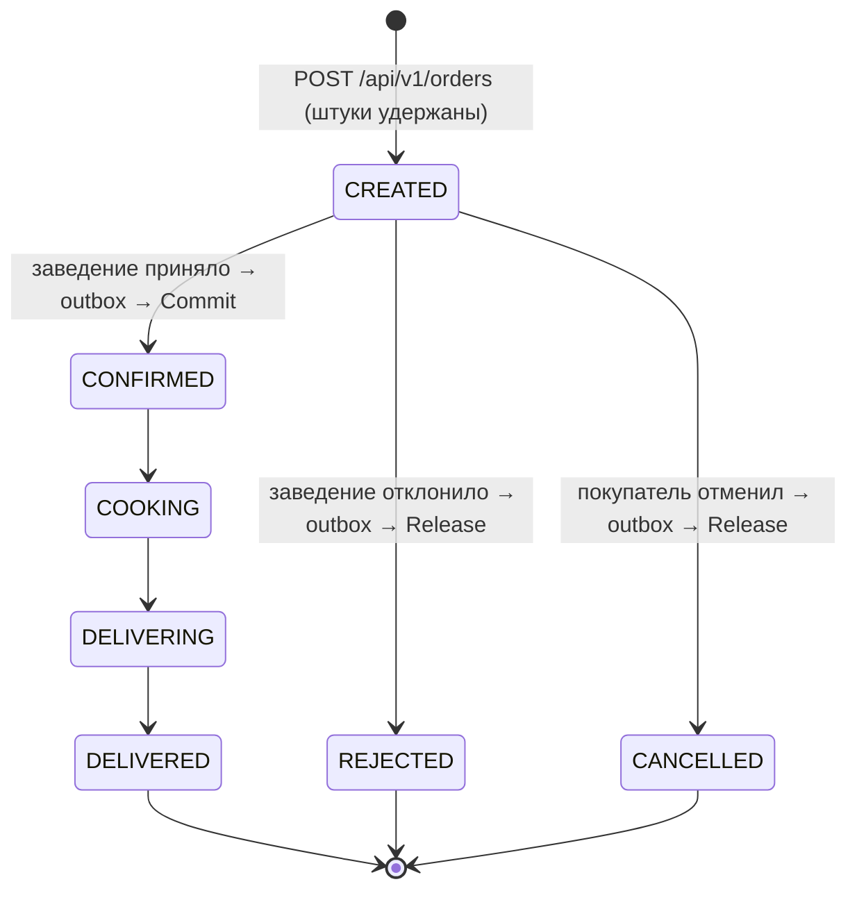
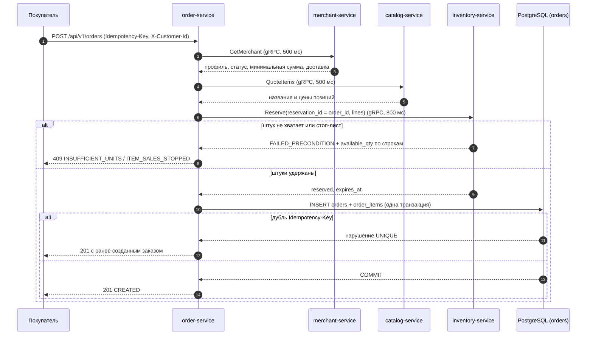

# Авито.Кухня — техническое задание, версия 3.0

| Поле | Значение |
|---|---|
| Версия | **3.0** |
| Дата | 2026-09-06 |
| Заменяет | v1.0 (`DESIGN.md`, полная микросервисная проработка) и v2.0 (`MVP-DESIGN.md`, упрощённый MVP на 5 дней) |
| Статус | Действующее ТЗ. Согласованный объём выполнен полностью: четыре бизнес-сервиса и `partner-pos` (см. §14) |
| Срок | 5 дней, один Go-разработчик, 8 продуктивных часов в день |
| Стек | Go 1.24+, PostgreSQL 18, gRPC между сервисами, чистая слоистая архитектура |

Метки источников: **[Ф]** — факт из задания Авито, **[О]** — обязательное ограничение заказчика, **[Р]** — проектное решение, **[Д]** — допущение.

---

## 1. Существенные изменения относительно версии 2.0

| № | Что изменилось | Причина | Влияние |
|---|---|---|---|
| 1 | **Четыре бизнес-микросервиса** вместо двух: `merchant-service`, `catalog-service`, `inventory-service`, `order-service` | **[О]** требование разделить систему на 3–4 полноценных бизнес-сервиса | Границы пересмотрены заново по владению данными и профилю нагрузки (§3), а не унаследованы |
| 2 | **Поштучный учёт наличия** вместо булева стоп-листа | **[О]** прямое требование: единица учёта — одна штука; отметка наличия не подтверждает количество | Появился `inventory-service` со своей моделью единиц, резервами и журналом движений (§5) |
| 3 | **Резервирование штук под заказ** с состояниями `HELD → COMMITTED / RELEASED` | Следствие п. 2: без резерва двое покупателей купят одну и ту же штуку | Появилась распределённая операция «оформление заказа» |
| 4 | **Transactional outbox в `order-service`** возвращён | Следствие п. 3: терминальное решение по заказу обязано надёжно дойти до `inventory-service` | Одна таблица + один фоновый обработчик (§8.4) |
| 5 | Идентичность заведения, ключи доступа и коммерческий профиль вынесены в отдельный сервис | Аутентификацией заведения пользуются три сервиса; хранение ключей в каталоге сделало бы каталог скрытым провайдером аутентификации | `merchant-service` стал единственным листом графа зависимостей и реализуется первым |
| 6 | `catalog-service` больше **не владеет** доступностью и остатками | Разделение «что продаётся и почём» и «сколько штук есть» | Каталог остаётся сервисом чтения с редкой записью; вся конкуренция сосредоточена в `inventory-service` |
| 7 | Зависимости **не вендорируются**: фиксация версий через `go.mod` и `go.sum` | Архив поставки не содержит исходников сторонних библиотек | Первая сборка требует сети (`make deps`); целостность проверяется `go mod verify` |
| 8 | Миграции применяет собственный runner (`pkg/pgmigrate`) вместо goose | Одна зависимость меньше; нужны ровно две возможности — упорядоченное применение и advisory-lock | ~120 строк, покрыты интеграционным тестом идемпотентности |

Всё остальное из версии 2.0 сохранено без изменений: отказ от Kafka, Redis, Kubernetes, service mesh и отдельного API Gateway; один экземпляр PostgreSQL с логическим разделением баз и ролей; идемпотентность оформления заказа; оптимистический контроль версий; целочисленные деньги; `limit`/`offset`-пагинация; базовые логи и проверки готовности без платформы наблюдаемости.

---

## 2. Требования и критерии приёмки

### 2.1 Требования задания Авито

| ID | Требование | Ответственный компонент |
|---|---|---|
| A-01 | API для заведений; закрытый список подключённых заведений | `merchant-service` (список и ключи), `catalog-service` (меню), `inventory-service` (остатки), `order-service` (очередь заказов) |
| A-02 | API для клиентской части; аутентификацию покупателей не реализовывать | Все четыре сервиса, публичные эндпоинты |
| A-03 | Один репозиторий | Монорепозиторий, один Go-модуль |
| A-04 | Основные пользовательские сценарии, включая наличие товара в заказе | §4.1 |
| A-05 | CJM со стороны заведения | §4.2 |
| A-06 | Пример одного заведения отдельным сервисом, запускаемым через Docker Compose | `partner-pos` |
| A-07 | Спроектировать API и схемы БД с расчётом на масштабирование | §6, §7, §11 |
| A-08 | Миграции со схемами БД в репозитории | `migrations/<service>` |
| A-09 | OpenAPI-спецификация в репозитории | `api/openapi/*.v1.yaml` |
| A-10 | Связать данные системы с данными заведений и пользователями | `merchant_id`, `menu_items.external_id`, `orders.customer_id` (§6) |
| A-11 | Язык — предпочтительно Go | Go 1.24+ |
| A-12 | БД на выбор | PostgreSQL 18 |
| A-13 | Запуск через Docker Compose | `docker-compose.yml` |
| A-14 | Линтер и статический анализ, конфигурация в репозитории | `.golangci.yml`, `go vet`, `go test -race` |
| A-15 | Кодогенерация для API (по желанию) | protoc + protoc-gen-go/-go-grpc для gRPC-контрактов |
| A-16 | Приложить промпт/plan (плюс) | `docs/PROMPT.md`, `docs/TZ-v3.0.md` |
| A-17 | Приложение поднимается и выполняет бизнес-сценарии | §13 |
| A-18 | CJM в виде code-generated диаграмм | `docs/cjm/*.puml` |
| A-19…A-21 | README: описание проекта, архитектура (C4 L2), описание схемы БД | `README.md`, `docs/c4/containers.puml` |
| A-22 | Упрощения описать и обосновать | README, §12 |
| A-23 | Показать подход к принятию технических решений | Раздел «Принятые решения» в README, §3 |

### 2.2 Обязательные ограничения заказчика

| ID | Ограничение | Как выполняется |
|---|---|---|
| Q-01 | Go | Go 1.24 (`go.mod`), сборка образов на `golang:1.24-alpine` |
| Q-02 | PostgreSQL | PostgreSQL 18, четыре логические БД, четыре пары ролей |
| Q-03 | 3–4 полноценных бизнес-микросервиса | Четыре: merchant, catalog, inventory, order (§3) |
| Q-04 | Межсервисное взаимодействие только gRPC и/или Kafka | Только gRPC; Kafka не вводится (§8.5) |
| Q-05 | Чистая слоистая архитектура внутри сервисов | `domain → app → adapters`, проверяется `depguard` (§10) |
| Q-06 | Владение данными | Одна логическая БД на сервис, роль сервиса не имеет прав на чужую БД (§6) |
| Q-07 | Поштучный учёт наличия | §5 целиком |
| Q-08 | Сохранить упрощения MVP и пятидневный срок | §12, §13 |
| Q-09 | Возможность масштабирования на десятки тысяч пользователей | §11 |
| Q-10 | Актуальные поддерживаемые зависимости | §9 |
| Q-11 | Не возвращать избыточную инфраструктуру и не добавлять незапрошенные функции | Инфраструктура: PostgreSQL. Всё |

### 2.3 Критерии приёмки

1. `docker compose up --build` из чистого клона поднимает систему без ручных шагов.
2. Все сценарии §4 выполняются через внешний HTTP API.
3. Поштучный учёт соблюдает инварианты §5.5 при конкурентных запросах.
4. Миграции применяются с нуля и повторно без изменения состояния.
5. OpenAPI-спецификации покрывают все внешние операции.
6. `go build`, `go vet`, `gofmt`, `go test -race` проходят без замечаний.
7. Интеграционные тесты выполняются против настоящего PostgreSQL.
8. README содержит описание проекта, архитектуру C4 L2, описание схемы БД и перечень упрощений.

---

## 3. Границы сервисов и обоснование их числа

### 3.1 Выбранное число: четыре бизнес-сервиса



### 3.2 Почему именно эти границы

| Сервис | Что делает бизнес-способность самостоятельной | Владеет данными | Профиль нагрузки | Кто зависит |
|---|---|---|---|---|
| **merchant-service** | Подключение заведения к площадке: закрытый список **[Ф]** A-01, выдача и отзыв ключей доступа, коммерческие условия (минимальная сумма, доставка, приём заказов) | `merchants`, `merchant_api_keys` | Почти только чтение; запись — редкие изменения профиля | catalog, inventory, order — все три аутентифицируют заведения через него |
| **catalog-service** | Что продаётся и почём: категории, позиции, названия, цены, версия меню | `menu_categories`, `menu_items` | Чтение доминирует, запись — публикация снимка меню целиком | order (`QuoteItems`) |
| **inventory-service** | Сколько штук доступно прямо сейчас: остатки, стоп-лист, резервы, журнал движений | `stock_items`, `stock_reservations`, `stock_reservation_lines`, `stock_movements`, `stock_operations` | Горячая запись по отдельной строке, максимальная конкуренция в системе | order (`Reserve`, `Commit`, `Release`) |
| **order-service** | Заказ и его жизненный цикл: предпросмотр, оформление, идемпотентность, статусы, надёжная доставка терминального решения | `orders`, `order_items`, `outbox_messages` | Смешанный; единственный сервис с фоновой обработкой | — |

### 3.3 Почему не три и не пять

| Рассмотренный вариант | Почему отклонён |
|---|---|
| Слить `merchant` в `catalog` (3 сервиса, как в v2.0) | Аутентификация заведения нужна `catalog`, `inventory` и `order`. Каталог стал бы провайдером аутентификации для двух чужих сервисов — скрытая связность, при которой отказ каталога ломает приём заказов и изменение остатков, хотя ни те, ни другие от меню не зависят |
| Слить `inventory` в `catalog` | Разные транзакционные границы и профили записи: публикация меню — редкая операция над многими строками, резервирование — частая операция над одной строкой с высокой конкуренцией. Совмещение заставило бы их конкурировать за один пул соединений и один узел записи; кроме того, публикация меню брала бы блокировки на строках, по которым идёт резервирование |
| Разделить `order` на «оформление» и «жизненный цикл» | Это один агрегат с общими инвариантами и одной таблицей. Разделение потребовало бы распределённой транзакции внутри одного агрегата — прямой антипаттерн |
| Добавить `notification`, `delivery`, `payment` | Заданием не предусмотрены; **[О]** запрещено добавлять незапрошенные функции |
| Считать `partner-pos` пятым бизнес-сервисом платформы | Он моделирует **внешнюю** организацию: у него нет доступа во внутреннюю сеть gRPC, он аутентифицируется ключом как обычное заведение. Это делает демонстрацию интеграции достоверной **[Ф]** A-06 |

### 3.4 Порядок реализации по зависимостям

```
merchant-service   (лист: ни от кого не зависит)
        ↓ AuthenticateApiKey
catalog-service · inventory-service   (зависят только от merchant, между собой не связаны)
        ↓ QuoteItems / Reserve
order-service      (зависит от всех трёх)
        ↓ внешний HTTP
partner-pos        (внешний потребитель публичных API)
```

`merchant-service` реализуется первым: он единственный не имеет исходящих зависимостей, и без него ни один другой сервис не может аутентифицировать заведение.

---

## 4. Сценарии

### 4.1 Покупатель

| ID | Сценарий | Сервис | Ключевые проверки |
|---|---|---|---|
| S-C1 | Найти заведение (список, фильтр по городу, поиск по названию/кухне) | merchant | Только активные заведения публичны |
| S-C2 | Посмотреть меню заведения с ценами и признаком доступности штук | catalog + inventory | Позиция помечается заказуемой только если `sales_state = ENABLED` **и** `available_qty > 0` |
| S-C3 | Предпросмотр заказа: пересчёт сумм и перечень проблем по каждой позиции | order → merchant + catalog + inventory | Доступность **по количеству**, принадлежность позиций заведению, минимальная сумма, приём заказов |
| S-C4 | Оформить заказ идемпотентно | order → inventory (`Reserve`) | Все проверки S-C3 + удержание штук all-or-nothing |
| S-C5 | Смотреть статус заказа | order | Заказ принадлежит этому `X-Customer-Id` |
| S-C6 | Отменить заказ до подтверждения | order → outbox → inventory (`Release`) | Статус `CREATED`; удержанные штуки возвращаются |
| S-C7 | История заказов | order | Пагинация |

**Трудности покупателя, которые задание просит проработать [Ф]:** позиция в стоп-листе; **штук меньше, чем запрошено**; заведение выключило приём заказов; заведение отключено оператором; сумма ниже минимальной; цена изменилась после предпросмотра; двойное нажатие «Оформить»; заведение отказало в заказе.

### 4.2 Заведение

| ID | Сценарий | Сервис | Ключевые проверки |
|---|---|---|---|
| S-M1 | Управлять профилем: приём заказов, минимальная сумма, доставка, время приготовления | merchant | Оптимистический контроль через `If-Match` |
| S-M2 | Опубликовать меню целым снимком | catalog | `If-Match: menu_version`, уникальность `external_id` |
| S-M3 | **Установить остаток позиции в штуках** (абсолютное значение) | inventory | Нельзя установить меньше уже удержанного |
| S-M4 | **Скорректировать остаток на дельту** (поступление, списание) | inventory | Идемпотентно по `operation_key` |
| S-M5 | Перевести позицию в стоп-лист и обратно | inventory | **Не изменяет количества** |
| S-M6 | Получать новые заказы | order | Опрос очереди раз в 5 с |
| S-M7 | Подтвердить или отклонить заказ | order → outbox → inventory | `Commit` либо `Release` удержанных штук |
| S-M8 | Продвинуть статус приготовления и доставки | order | Матрица переходов |

---

## 5. Поштучный учёт наличия (ядро версии 3.0)

**[О]** Требование: единица учёта — одна штука товара; отметка наличия позиции не должна автоматически подтверждать всё её количество; серийные номера и складская подсистема не вводятся.

### 5.1 Модель единиц

| Понятие | Определение |
|---|---|
| **Единица учёта** | Одна штука товарной позиции, готовая к продаже у конкретного заведения |
| **Однородность** | Штуки одной позиции взаимозаменяемы. Отдельная штука **не идентифицируется**: серийных номеров, партий, сроков годности и мест хранения нет — их нет и в задании |
| **Учётный объект** | «Карточка остатка» `stock_item`, идентифицируемая парой (`merchant_id`, `menu_item_id`). Именно она, а не отдельная штука, имеет идентичность и версию |
| **Идентификация позиции** | `menu_item_id` — идентификатор позиции в каталоге площадки; `external_id` — идентификатор той же позиции в системе заведения **[Ф]** A-10. `inventory-service` хранит `menu_item_id` как непрозрачный идентификатор |

### 5.2 Величины

| Величина | Тип | Смысл |
|---|---|---|
| `on_hand_qty` | `integer ≥ 0` | Сколько штук физически есть к продаже. Меняет только заведение |
| `reserved_qty` | `integer ≥ 0` | Сколько штук удержано под неподтверждённые заказы. Меняет только платформа |
| `available_qty` | вычисляемое | `on_hand_qty − reserved_qty`. Именно эта величина сравнивается с запрошенным количеством |
| `version` | `bigint` | Растёт при каждом изменении карточки; основа оптимистического контроля |

### 5.3 Состояния

**Стоп-лист позиции** — измерение, независимое от количеств:

| `sales_state` | Смысл |
|---|---|
| `ENABLED` | Заведение разрешает продажу позиции |
| `STOPPED` | Позиция снята с продажи независимо от того, сколько штук числится |

**Ключевое правило [О]:** перевод в `ENABLED` **не изменяет ни `on_hand_qty`, ни `reserved_qty`**. Карточка создаётся с `on_hand_qty = 0`; пока заведение явно не укажет количество, позиция не заказуема, даже будучи `ENABLED`. Публикация меню в `catalog-service` остатков не создаёт и не подтверждает.

**Резерв:**



### 5.4 Операции

| Операция | Кто вызывает | Транспорт | Семантика повтора |
|---|---|---|---|
| `SetOnHand(menu_item_id, qty)` | заведение | HTTP `PUT /api/v1/merchant/stock/{menu_item_id}` | Идемпотентна по значению; `If-Match` по версии карточки |
| `AdjustOnHand(menu_item_id, delta, reason, operation_key)` | заведение | HTTP `POST /api/v1/merchant/stock/{menu_item_id}/adjust` | **Неидемпотентна по природе** → дедупликация по `operation_key` (UNIQUE): повтор ничего не меняет и возвращает текущую карточку с `duplicate = true`; исход первого применения хранится в `stock_operations.result` |
| `SetSalesState(menu_item_id, state)` | заведение | HTTP `PATCH /api/v1/merchant/stock/{menu_item_id}` | Идемпотентна (присваивание) |
| `GetAvailability(merchant_id, ids[])` | покупатель, order | HTTP + gRPC | Только чтение |
| `Reserve(reservation_id, merchant_id, lines[], ttl)` | order | gRPC | Идемпотентна по `reservation_id` |
| `CommitReservation(reservation_id)` | order (outbox) | gRPC | Идемпотентна по условию `state = 'HELD'` |
| `ReleaseReservation(reservation_id, reason)` | order (outbox), sweeper | gRPC | Идемпотентна по тому же условию |

### 5.5 Ограничения и инварианты

| ID | Инвариант | Механизм |
|---|---|---|
| INV-S1 | `on_hand_qty ≥ 0` | `CHECK` |
| INV-S2 | `reserved_qty ≥ 0` | `CHECK` |
| INV-S3 | `reserved_qty ≤ on_hand_qty` | `CHECK` — ни одна операция не может удержать больше, чем есть |
| INV-S4 | Резерв создаётся только если по **каждой** строке `sales_state = ENABLED` и `available_qty ≥ qty` | Условный `UPDATE` на строку, 0 изменённых строк ⇒ откат всей транзакции |
| INV-S5 | Резерв ровно один раз переходит в `COMMITTED` или `RELEASED` | `UPDATE ... WHERE id = $1 AND state = 'HELD'` |
| INV-S6 | Один `reservation_id` порождает одно удержание | Первичный ключ таблицы резервов |
| INV-S7 | Один `operation_key` применяется один раз | `UNIQUE (stock_item_id, operation_key)` |
| INV-S8 | Изменение `sales_state` не изменяет количеств | Отдельный `UPDATE`, не затрагивающий колонки количеств; проверяется unit-тестом |
| INV-S9 | Каждое изменение количеств отражено в журнале движений | Вставка в `stock_movements` в той же транзакции |
| INV-S10 | Количество в строке резерва > 0 | `CHECK` |

### 5.6 Конкурентные и повторные изменения

| Ситуация | Поведение |
|---|---|
| Двое покупателей одновременно резервируют последнюю штуку | Условный `UPDATE ... SET reserved_qty = reserved_qty + $qty WHERE ... AND on_hand_qty - reserved_qty >= $qty` блокирует строку; ровно один получает 1 изменённую строку, второй — 0 и отказ `INSUFFICIENT_UNITS` с фактическим `available_qty` |
| Многопозиционный заказ, взаимные блокировки | Строки захватываются в порядке возрастания `menu_item_id` внутри транзакции; детерминированный порядок исключает deadlock |
| Повтор `Reserve` с тем же `reservation_id` | Вставка резерва `ON CONFLICT DO NOTHING`; если резерв уже существует, количества **не удерживаются повторно**, возвращается `already_existed = true` и прежний результат |
| Одновременные `Commit` и `Release` одного резерва | Условие `state = 'HELD'` пропускает ровно одну транзакцию; вторая получает `FAILED_PRECONDITION` с текущим состоянием |
| Повтор `Commit` после успешного `Commit` | 0 изменённых строк, чтение состояния, ответ `already_committed = true` — успех |
| Повтор `AdjustOnHand` с тем же `operation_key` | Вставка ключа `ON CONFLICT DO NOTHING` не проходит, дельта не применяется; ответ — текущая карточка с `duplicate = true`; остаток меняется один раз |
| Установка или корректировка остатка одновременно с резервом, списанием или другой корректировкой | Операции заведения (`SetOnHand`, `AdjustOnHand`, `SetSalesState`) блокируют карточку `SELECT … FOR UPDATE` до конца своей транзакции и вычисляют новое значение из заблокированной строки. Поэтому ни конкурентная дельта, ни списание подтверждённого заказа не теряются, а запись журнала отражает фактическое изменение (INV-S9) |
| Заведение уменьшает `on_hand_qty` ниже `reserved_qty` | Отказ 409 `BELOW_RESERVED` с текущими значениями. Клампинг не применяется: молча «потерять» удержанные штуки нельзя |
| Заведение переводит позицию в `STOPPED` при активных резервах | Разрешено: стоп-лист запрещает **новые** резервы, уже удержанные штуки остаются за заказами |
| Просроченный резерв | Фоновый sweeper переводит `HELD → RELEASED` по `expires_at`, возвращая штуки; операция идемпотентна и совпадает по эффекту с `ReleaseReservation` |
| Гонка sweeper и `Commit` | Оба используют условие `state = 'HELD'`; выигрывает первый, второй получает конфликт и логируется |

### 5.7 Что сознательно не вводится

| Не вводится | Почему |
|---|---|
| Серийные номера, партии, сроки годности | **[О]** прямо запрещено; в задании нет требований, которые бы этого потребовали |
| Склады, места хранения, перемещения между складами | То же; учёт ведётся в разрезе (заведение, позиция) |
| Отрицательные остатки и продажа «в минус» | Нарушало бы INV-S1 и смысл поштучного учёта |
| Автоматическое пополнение остатка при публикации меню | Прямо противоречит требованию «отметка наличия не подтверждает количество» |

---

## 6. Модель данных

Один экземпляр PostgreSQL, четыре логические базы, по две роли на каждую (`<service>_svc` — только DML, `<service>_migrator` — владелец схемы). Роль сервиса не имеет прав на чужую базу, поэтому прямой доступ к чужим таблицам невозможен физически, а не по договорённости. Межбазовых `JOIN`, внешних ключей через границу владения и транзакций, охватывающих две базы, нет.

Денежные величины — целые в копейках, валюта `RUB`. Время — `timestamptz` в UTC, в API формат RFC 3339.

### 6.1 БД `merchant` (реализована)

| Таблица | Поля | Ключи, ограничения, индексы |
|---|---|---|
| `merchants` | `id uuid`, `slug`, `name`, `description`, `cuisine`, `city`, `address`, `phone`, `status`, `is_accepting_orders`, `min_order_minor`, `delivery_fee_minor`, `avg_prep_minutes`, `version`, `created_at`, `updated_at` | PK (`id`); UNIQUE (`slug`); CHECK `status IN ('ACTIVE','SUSPENDED')`; CHECK `min_order_minor BETWEEN 0 AND 10000000`; CHECK `delivery_fee_minor BETWEEN 0 AND 1000000`; CHECK `avg_prep_minutes BETWEEN 1 AND 240`; CHECK `version > 0`; индекс (`city`, `name`, `id`) WHERE `status = 'ACTIVE'` — обслуживает S-C1 |
| `merchant_api_keys` | `key_hash bytea`, `merchant_id uuid`, `label`, `is_active`, `created_at`, `revoked_at` | PK (`key_hash`) — обслуживает `AuthenticateApiKey`; FK на `merchants(id)`; CHECK `octet_length(key_hash) = 32`; CHECK согласованности `is_active`/`revoked_at`; индекс (`merchant_id`) |

`status` меняет только оператор площадки; `is_accepting_orders` — само заведение. Разделение намеренное: отключение оператором и оперативная пауза — разные решения разных субъектов.

### 6.2 БД `catalog`

| Таблица | Поля | Ключи и ограничения |
|---|---|---|
| `menu_categories` | `id uuid`, `merchant_id uuid`, `name`, `position` | PK (`id`); UNIQUE (`merchant_id`, `name`) |
| `menu_items` | `id uuid`, `merchant_id uuid`, `category_id uuid`, `external_id`, `name`, `description`, `price_minor bigint`, `is_deleted bool`, `position`, `updated_at` | PK (`id`); UNIQUE (`merchant_id`, `external_id`) **[Ф]** A-10; CHECK `price_minor > 0`; индекс (`merchant_id`, `category_id`, `position`) WHERE NOT `is_deleted` |
| `merchant_menu_state` | `merchant_id uuid`, `menu_version bigint`, `updated_at` | PK (`merchant_id`); CHECK `menu_version > 0`. Отдельная таблица, потому что каталог не владеет сущностью заведения и не может хранить версию в чужой строке |

Публикация меню — одна транзакция: инкремент `menu_version` при совпадении `If-Match`, upsert позиций по (`merchant_id`, `external_id`), пометка отсутствующих `is_deleted = true`. Позиции не удаляются физически: на них ссылаются снимки в заказах и карточки остатков.

### 6.3 БД `inventory`

| Таблица | Поля | Ключи и ограничения |
|---|---|---|
| `stock_items` | `id uuid`, `merchant_id uuid`, `menu_item_id uuid`, `sales_state text`, `on_hand_qty int`, `reserved_qty int`, `version bigint`, `created_at`, `updated_at` | PK (`id`); UNIQUE (`merchant_id`, `menu_item_id`); CHECK `sales_state IN ('ENABLED','STOPPED')`; CHECK `on_hand_qty >= 0`; CHECK `reserved_qty >= 0`; **CHECK `reserved_qty <= on_hand_qty`**; индекс (`merchant_id`, `menu_item_id`) |
| `stock_reservations` | `id uuid` (= `order_id`), `merchant_id uuid`, `state text`, `expires_at`, `created_at`, `updated_at` | PK (`id`) — идемпотентность `Reserve`; CHECK `state IN ('HELD','COMMITTED','RELEASED')`; индекс (`expires_at`) WHERE `state = 'HELD'` — обслуживает sweeper |
| `stock_reservation_lines` | `reservation_id uuid`, `stock_item_id uuid`, `menu_item_id uuid`, `qty int` | PK (`reservation_id`, `stock_item_id`); CHECK `qty > 0` |
| `stock_movements` | `id bigint identity`, `stock_item_id uuid`, `kind text`, `delta_on_hand int`, `delta_reserved int`, `reservation_id uuid NULL`, `operation_key text NULL`, `reason text`, `created_at` | CHECK `kind IN ('SET','ADJUST','RESERVE','RELEASE','COMMIT','EXPIRE')`; индекс (`stock_item_id`, `id`). Append-only журнал: восстанавливает историю каждого изменения количества |
| `stock_operations` | `stock_item_id uuid`, `operation_key text`, `result jsonb`, `created_at` | PK (`stock_item_id`, `operation_key`) — дедупликация `AdjustOnHand` (INV-S7) |

### 6.4 БД `orders`

| Таблица | Поля | Ключи и ограничения |
|---|---|---|
| `orders` | `id uuid`, `merchant_id uuid`, `merchant_name`, `customer_id uuid`, `idempotency_key text`, `customer_name`, `customer_phone`, `delivery_address`, `comment`, `status text`, `items_total_minor`, `delivery_fee_minor`, `total_minor`, `currency`, `eta_minutes`, `reject_reason`, `created_at`, `updated_at` | PK (`id`); **UNIQUE (`customer_id`, `idempotency_key`)**; CHECK `status IN (...)`; CHECK `total_minor = items_total_minor + delivery_fee_minor`; индекс (`merchant_id`, `status`, `created_at`); индекс (`customer_id`, `created_at DESC`) |
| `order_items` | `order_id uuid`, `menu_item_id uuid`, `external_id`, `name`, `unit_price_minor`, `qty`, `line_total_minor` | PK (`order_id`, `menu_item_id`); CHECK `qty BETWEEN 1 AND 99`; CHECK `line_total_minor = unit_price_minor * qty`. Снимок названия и цены на момент оформления |
| `outbox_messages` | `id uuid`, `aggregate_id uuid`, `type text`, `payload jsonb`, `correlation_id`, `state text`, `attempts int`, `available_at`, `last_error`, `created_at`, `updated_at` | PK (`id`); CHECK `state IN ('PENDING','SENT','FAILED')`; индекс (`available_at`, `id`) WHERE `state = 'PENDING'` |

### 6.5 Статусная модель заказа



Любой другой переход — 409 `ORDER_STATE_CONFLICT`. Повтор перехода в уже установленный статус возвращает 200 без изменения состояния, что делает операции заведения идемпотентными без дополнительного заголовка.

---

## 7. Контракты

### 7.1 Общие правила внешнего HTTP API

| Правило | Значение |
|---|---|
| Базовый путь | `/api/v1` |
| Формат | `application/json; charset=utf-8` |
| Аутентификация заведения | `X-Api-Key` |
| Идентификация покупателя | `X-Customer-Id: <uuid>` (не средство аутентификации, **[Ф]** A-02) |
| Идемпотентность оформления | `Idempotency-Key: <uuid>` на `POST /api/v1/orders` |
| Корреляция | `X-Request-Id` принимается и всегда возвращается |
| Пагинация | `limit` (1–50, по умолчанию 20), `offset` (≥ 0); в ответе `items`, `total`, `limit`, `offset` |
| Оптимистический контроль | `ETag` в ответе, `If-Match` в запросе; несовпадение — 412 `VERSION_CONFLICT` |
| Формат ошибки | `{"error":{"code","message","details":[{"field","reason"}],"request_id"}}` |

Общие коды ошибок, единые для всех сервисов: `VALIDATION_FAILED`, `UNAUTHORIZED`, `NOT_FOUND`, `CONFLICT`, `VERSION_CONFLICT`, `PAYLOAD_TOO_LARGE`, `UNSUPPORTED_MEDIA_TYPE`, `DEPENDENCY_UNAVAILABLE`, `TIMEOUT`, `INTERNAL_ERROR`.

### 7.2 Внешние эндпоинты по сервисам

**merchant-service** (порт 8081) — реализован, спецификация `api/openapi/merchant.v1.yaml`:

| Метод и путь | Назначение |
|---|---|
| `GET /api/v1/merchants` | Список активных заведений: `city`, `q`, `only_accepting`, `limit`, `offset` |
| `GET /api/v1/merchants/{merchant_id}` | Карточка заведения (отключённые — 404) |
| `GET /api/v1/merchant/profile` | Свой профиль, `ETag` |
| `PATCH /api/v1/merchant/profile` | Частичное изменение профиля, `If-Match` |

**catalog-service** (порт 8082) — реализован, спецификация `api/openapi/catalog.v1.yaml`:

| Метод и путь | Назначение |
|---|---|
| `GET /api/v1/merchants/{merchant_id}/menu` | Меню с `menu_version` |
| `GET /api/v1/merchant/menu` | Своё меню |
| `PUT /api/v1/merchant/menu` | Публикация снимка, `If-Match: menu_version` |
| `PATCH /api/v1/merchant/menu/items/{item_id}` | Изменение цены и названия позиции |

**inventory-service** (порт 8083) — реализован, спецификация `api/openapi/inventory.v1.yaml`:

| Метод и путь | Назначение |
|---|---|
| `GET /api/v1/merchants/{merchant_id}/availability?menu_item_ids=` | Публичная доступность в штуках |
| `GET /api/v1/merchant/stock` | Свои карточки остатков |
| `PUT /api/v1/merchant/stock/{menu_item_id}` | `SetOnHand`, `If-Match` |
| `POST /api/v1/merchant/stock/{menu_item_id}/adjust` | `AdjustOnHand`, `operation_key` |
| `PATCH /api/v1/merchant/stock/{menu_item_id}` | `SetSalesState` |
| `GET /api/v1/merchant/stock/{menu_item_id}/movements` | Журнал движений |

**order-service** (порт 8084) — реализован, спецификация `api/openapi/order.v1.yaml`:

| Метод и путь | Назначение |
|---|---|
| `POST /api/v1/orders/preview` | Предпросмотр с перечнем проблем по позициям |
| `POST /api/v1/orders` | Оформление, `Idempotency-Key` |
| `GET /api/v1/orders/{order_id}` | Статус заказа |
| `GET /api/v1/orders` | История покупателя |
| `POST /api/v1/orders/{order_id}/cancel` | Отмена до подтверждения |
| `GET /api/v1/merchant/orders` | Очередь заказов заведения |
| `GET /api/v1/merchant/orders/{order_id}` | Карточка заказа |
| `POST /api/v1/merchant/orders/{order_id}/accept` | Подтверждение, `eta_minutes` |
| `POST /api/v1/merchant/orders/{order_id}/reject` | Отказ с причиной |
| `POST /api/v1/merchant/orders/{order_id}/status` | Продвижение статуса |

**partner-pos** (порт 8085) — реализован, спецификация `api/openapi/partner-pos.v1.yaml`; собственный API управления демонстрацией: `GET /pos/menu`, `PATCH /pos/menu/{external_id}`, `POST /pos/publish`, `GET /pos/orders`, `PUT /pos/behavior`.

### 7.3 Внутренние gRPC-контракты (зафиксированы полностью)

Исходники — `api/proto/*/v1/*.proto`, сгенерированный код — `gen/grpc/*/v1/`. Контракты зафиксированы заранее, чтобы последующие сервисы интегрировались без переделок.

| Сервис | Метод | Вызывающий | Deadline | Идемпотентность |
|---|---|---|---|---|
| `merchant.v1.MerchantService` | `AuthenticateApiKey` | catalog, inventory, order | 300 мс | да (чтение) |
| | `GetMerchant` | order | 500 мс | да (чтение) |
| | `GetMerchants` | order | 500 мс | да (чтение) |
| `catalog.v1.CatalogService` | `QuoteItems` | order | 500 мс | да (чтение) |
| `inventory.v1.InventoryService` | `GetAvailability` | order | 500 мс | да (чтение) |
| | `Reserve` | order | 800 мс | да, по `reservation_id` |
| | `CommitReservation` | order (outbox) | 3 с | да, по состоянию `HELD` |
| | `ReleaseReservation` | order (outbox) | 3 с | да, по состоянию `HELD` |

Отображение ошибок наружу единое для всех сервисов:

| Ситуация | gRPC-статус | HTTP |
|---|---|---|
| Некорректные аргументы | `INVALID_ARGUMENT` | 422 `VALIDATION_FAILED` |
| Объект не найден | `NOT_FOUND` | 404 |
| Ключ неизвестен или отозван | `NOT_FOUND` | 401 `UNAUTHORIZED` |
| Стоп-лист, нехватка штук, закрытое заведение | `FAILED_PRECONDITION`; детализация по строкам передаётся в деталях статуса (`ReserveResponse` в `status.details`), поскольку gRPC отбрасывает тело ответа при ошибке | 409 с конкретным кодом |
| Конкурентный конфликт | `ABORTED` | 409 / 412 |
| Deadline, недоступность | `DEADLINE_EXCEEDED`, `UNAVAILABLE` | 503 `DEPENDENCY_UNAVAILABLE` |
| Внутренняя ошибка | `INTERNAL` | 500 `INTERNAL_ERROR` без технических деталей |

### 7.4 Правила совместимого изменения

Добавление необязательного поля, нового значения enum, нового метода — совместимо. Изменение номера или типа поля protobuf, удаление поля, изменение кода ответа для существующей ситуации — несовместимо и требует новой версии пакета (`v2`).

---

## 8. Согласованность и надёжность

### 8.1 Оформление заказа



Операция считается успешной в момент фиксации транзакции в `orders`. Резерв, созданный до неё, — единственное окно рассогласования; оно закрывается TTL резерва и sweeper'ом в `inventory-service`.

### 8.2 Идемпотентность оформления

Ключ — `Idempotency-Key`, область уникальности — пара (`customer_id`, ключ), хранилище — колонка `orders.idempotency_key` с UNIQUE-индексом, срок — время жизни заказа. Вставка заказа и ключа выполняется одной транзакцией: конфликт уникальности означает повтор, и клиенту возвращается ранее созданный заказ. Отдельная таблица, двухфазный захват и перехват зависших ключей не нужны, потому что между внешним вызовом и локальной фиксацией нет второго изменения состояния платформы, которое пришлось бы откатывать.

### 8.3 Терминальные решения по заказу

Подтверждение, отказ и отмена меняют статус и вставляют сообщение в `outbox_messages` **в одной транзакции** (решение проблемы двойной записи). Фоновый диспетчер выбирает пачку `FOR UPDATE SKIP LOCKED`, вызывает `CommitReservation` либо `ReleaseReservation` и отмечает результат. Гарантия пути — at-least-once доставка плюс идемпотентный приёмник, то есть однократность **эффекта**; `exactly-once` на уровне доставки не заявляется.

Повторы: до 12 попыток с экспоненциальной задержкой 1→2→4→…→300 с; `INVALID_ARGUMENT` от приёмника повторам не подлежит и сразу переводит сообщение в `FAILED` с метрикой в логе. TTL резерва (30 минут) заведомо больше окна повторов, поэтому потеря `Release` не приводит к вечному удержанию штук: их вернёт sweeper.

### 8.4 Разбор отказов

| Отказ | Что видит клиент | Механизм корректности |
|---|---|---|
| Повтор `POST /orders` | 201 с тем же `order_id` | UNIQUE (`customer_id`, `idempotency_key`) |
| Двое берут последнюю штуку | Один 201, второй 409 `INSUFFICIENT_UNITS` | Условный `UPDATE` (INV-S4) |
| Падение `order-service` между `Reserve` и фиксацией | Ошибка соединения | Резерв висит `HELD` до `expires_at`, sweeper возвращает штуки. Повтор с тем же `Idempotency-Key` оформляет заказ заново: идентификатор резерва — новый идентификатор заказа, поэтому создаётся новый резерв, а осиротевший возвращается по TTL |
| Потеря ответа `Reserve` | 503 `DEPENDENCY_UNAVAILABLE`, заказ не создан | Если удержание всё же состоялось, его возвращает sweeper по TTL. Идемпотентность `Reserve` по `reservation_id` защищает от двойного удержания при повторе того же вызова, но `order-service` такой вызов не повторяет |
| Падение после фиксации, до отправки сообщения | Статус уже изменён | Сообщение лежит в outbox той же транзакции |
| Падение диспетчера после gRPC, до отметки `SENT` | Прозрачно | Повторная отправка, приёмник идемпотентен |
| `inventory-service` недоступен при оформлении | 503 `DEPENDENCY_UNAVAILABLE`, заказ не создан | Ничего не удержано |
| `inventory-service` недоступен при подтверждении | Заведение получает 200 | Сообщения копятся в outbox и расходятся после восстановления |
| Перезапуск любого сервиса | Активные запросы завершаются | `/readyz` краснеет до закрытия слушателей, graceful shutdown 25 с |

### 8.5 Почему не Kafka

**[О]** допускает gRPC и/или Kafka, требуя отдельной необходимой задачи для каждого механизма. Асинхронный обмен в системе один — доставка терминального решения из `order-service` в `inventory-service`, у него ровно один потребитель, и надёжность обеспечивает outbox. Брокер добавил бы инфраструктуру, не изменив гарантий. Условия введения: появление второго независимого потребителя событий заказа, требование повторно проигрывать поток, вынос событий во внешнюю аналитику. Переход затрагивает один адаптер диспетчера — домен, схема и внешние контракты не меняются.

---

## 9. Технологии и версии

| Компонент | Версия | Обоснование |
|---|---|---|
| Go | `go 1.24` в `go.mod`; образы собираются на `golang:1.24-alpine` | Директива задаёт минимальную версию; сборка более новым тулчейном совместима |
| PostgreSQL | 18 (образ `postgres:18.6-alpine`) | Текущая мажорная версия; 19 на дату проектирования в бете и не берётся |
| Драйвер | `github.com/jackc/pgx/v5` v5.7.5 | Нативный протокол, пул, точные коды ошибок |
| gRPC | `google.golang.org/grpc` v1.73.0 | Последняя линия, чьи зависимости совместимы с Go 1.24. Версия v1.74.x тянет `genproto`, требующий Go ≥ 1.25, что противоречило бы директиве `go 1.24` |
| Protobuf | `google.golang.org/protobuf` v1.36.6 | Актуальная линия |
| UUID | `github.com/google/uuid` v1.6.0 | Генерация идентификаторов приложением |
| HTTP | стандартный `net/http` с маршрутизацией по шаблонам Go 1.22+ | Внешних роутеров не требуется |
| Логи | стандартный `log/slog` (JSON) | Без внешней зависимости |
| Миграции | `pkg/pgmigrate` (собственный, ~120 строк) | Нужны упорядоченное применение и advisory-lock; отдельная зависимость не оправдана |
| Тесты | стандартный `testing` + `bufconn` | Без ассерт-библиотек |
| Линтер | golangci-lint v2, конфигурация `.golangci.yml` | **[Ф]** A-14 |
| Кодогенерация | protoc + protoc-gen-go + protoc-gen-go-grpc | **[Ф]** A-15 |

Зависимости не вендорируются: версии фиксированы `go.mod` и контрольными суммами `go.sum`, целостность проверяется командой `go mod verify`. Первая сборка на «холодном» кэше требует доступа к прокси модулей (`make deps`).

---

## 10. Слои и структура кода

| Слой | Содержит | Запрещено |
|---|---|---|
| `domain` | Сущности, значения, инварианты, доменные ошибки | Импорт `net/http`, `pgx`, `grpc`, сгенерированных моделей |
| `app` | Сценарии, интерфейсы портов, границы транзакций | Прямой SQL, вызовы gRPC-клиента, знание HTTP-кодов |
| `adapters/httpapi`, `adapters/grpcapi` | Реализация внешних контрактов, преобразование DTO и ошибок | Бизнес-правила |
| `adapters/postgres`, `adapters/grpcclient` | SQL, gRPC-клиенты | Бизнес-правила |
| `pkg/*` | Общая техника: логи, конфигурация, HTTP-обвязка, пул и транзакции, миграции, gRPC-обвязка | Любая бизнес-логика и импорт `internal/` |

Направления зависимостей проверяются автоматически: правила `depguard` в `.golangci.yml` запрещают импорт инфраструктуры из `domain` и `app`, импорт адаптеров из `app`, кросс-сервисные импорты между `internal/<service>` и импорт `internal/` из `pkg/`. Нарушение ломает сборку CI.

Полное дерево каталогов и файлов создаётся командой `scripts/create-structure.sh` (см. §14.3): 96 каталогов, 176 файлов.

---

## 11. Масштабирование

**[Д]** Профиль нагрузки в задании не задан. Ориентир для расчёта: дневная аудитория 10 000, 25 % оформляют заказ (2 500 заказов в сутки), 200 активных заведений, опрос статуса заказа раз в 15 с в течение 40 минут, опрос очереди заведением раз в 5 с в течение 14 часов, 20 % суточного объёма в час пика с внутричасовым коэффициентом 1,5.

```
N_сут ≈ 10 000×7 + 2 500×(3+160+4) + 200×10 080 ≈ 2 500 000 запросов/сутки
RPS_средн ≈ 29,  RPS_пик ≈ 2 500 000 × 0,2 × 1,5 / 3600 ≈ 209
```

Общее число пользователей, дневная аудитория, одновременно активные пользователи, открытые соединения и RPS — разные величины и не приравниваются.

### 11.1 Что заложено сейчас

| Решение | Что даёт |
|---|---|
| Ни одного элемента состояния в памяти процесса: корзина у клиента, идемпотентность в БД, резервы в БД, никаких локальных блокировок | Несколько экземпляров любого сервиса запускаются без изменения кода |
| Идентификаторы генерирует приложение | Вставка не требует обращения к БД за идентификатором |
| Индексы ровно под фактические запросы | Отсутствие полных сканирований на горячих путях |
| Снимок названий и цен в `order_items` | Чтение заказа не порождает межсервисных вызовов |
| Ограниченный пул соединений на экземпляр | Число backend-процессов PostgreSQL предсказуемо |
| Тайм-ауты на каждом уровне, `context` по всей цепочке | Медленный клиент или зависимость не удерживают соединения |
| Короткие транзакции без сетевых вызовов внутри | Отсутствие длинных блокировок |
| `MaxConnectionAge` на gRPC-серверах | Клиенты периодически пере-резолвят адрес, новые экземпляры получают трафик |

### 11.2 Ожидаемые узкие места

| Узкое место | Метрика приближения | Изменение | Ломает ли контракты |
|---|---|---|---|
| Опрос очереди заведениями (доминирует в трафике) | Доля пустых ответов очереди | Необязательный параметр `wait` (long-poll) + `LISTEN/NOTIFY` | Нет |
| Опрос статуса заказа | Доля повторных ответов с неизменным телом | `ETag` / `If-None-Match` | Нет |
| «Горячая» строка `stock_items` популярной позиции | Время ожидания блокировок в `pg_locks` | Транзакция резервирования уже коротка и не содержит сетевых вызовов; далее — секционирование остатка на несколько строк | Нет |
| Один экземпляр сервиса | CPU контейнера выше ~70 % | Несколько экземпляров + L7-балансировщик | Нет |
| Пул соединений PostgreSQL | Время ожидания соединения из пула | Пересчитать бюджет `Σ(экземпляры × пул) ≤ 60 % от max_connections`, затем внешний пулер | Нет |
| Чтение упирается в узел БД | CPU узла при неизменной доле записи | Оптимизация запросов → ресурсы узла → реплики чтения для меню и списка заведений (но не для статуса заказа: реплика может отставать) | Нет |
| Пагинация `OFFSET` на глубоких страницах | Наблюдаемые запросы с `offset > 1000` | Keyset-курсор | Частично: добавляется параметр `cursor` |
| Рост `orders`, `stock_movements` | Число строк свыше ~20 млн | Партиционирование по времени | Нет |

Добавление экземпляров приложения не масштабирует запись в PostgreSQL — это отдельная ось, шаги по ней перечислены отдельно.

### 11.3 Нагрузочный прогон

Один воспроизводимый прогон k6: смесь операций в пропорции профиля, плавный рост до ~200 RPS, 10 минут, по одному экземпляру каждого сервиса. Собираются RPS, p95/p99, доля ошибок, `docker stats`, `pg_stat_statements`. Цель — обнаружить очевидные проблемы (отсутствующий индекс, исчерпание пула, утечка соединений), а не доказать устойчивость. Результат такого прогона не является доказательством работы при десятках тысяч одновременных пользователей.

---

## 12. Сохранённые упрощения MVP

| Упрощение | Обоснование |
|---|---|
| Аутентификация покупателей отсутствует, идентификация по непроверяемому `X-Customer-Id` | **[Ф]** A-02 прямо исключает |
| Онлайн-оплата отсутствует | В задании не упомянута |
| Курьерская логистика отсутствует; статусы доставки двигает заведение | В задании не описана |
| Рабочие часы заведения не моделируются; приём заказов — переключатель `is_accepting_orders` | Сценарий «заведение закрыто» покрывается переключателем |
| Пагинация `limit`/`offset` вместо keyset | Достаточно при объёмах MVP; триггер перехода назван |
| Метрики Prometheus не вводятся; наблюдаемость — структурные логи, `/healthz`, `/readyz` | **[О]** без расширенной платформы наблюдаемости |
| Единый экземпляр PostgreSQL с логическим разделением | Достаточно для воспроизводимой сдачи; изоляция обеспечена ролями |
| Штуки однородны, серийных номеров нет | **[О]** прямо запрещено |

---

## 13. План на пять дней

**[Д]** Допущение планирования: один Go-разработчик, без DevOps и QA, 8 продуктивных часов в день, 40 часов всего.

| День | Работы | Часы | Проверяемый результат |
|---|---|---:|---|
| **1** | Репозиторий, `go.mod` и `go.sum` (без вендоринга, см. §1), линтер с правилами границ. Все контракты: 3 proto + 4 OpenAPI, генерация. Общие пакеты `logx`, `envcfg`, `httpx`, `pgxx`, `pgmigrate`, `grpcx`. Миграции четырёх БД, роли и права. Docker Compose с PostgreSQL и job миграций. **merchant-service целиком** с тестами | 8 | `docker compose up` поднимает PostgreSQL и merchant-service; все эндпоинты и gRPC-методы работают; тесты зелёные |
| **2** | **inventory-service целиком**: домен поштучного учёта, репозитории с условными `UPDATE`, журнал движений, дедупликация операций, резервы, sweeper, HTTP и gRPC, интеграционные и конкурентные тесты | 8 | Резерв последней штуки конкурентно даёт ровно один успех; повторы идемпотентны |
| **3** | **catalog-service целиком** (меню, снимок с версией, `QuoteItems`). Начало **order-service**: домен, репозитории, gRPC-клиенты, предпросмотр и оформление с идемпотентностью | 8 | Покупатель проходит путь до созданного заказа с удержанием штук |
| **4** | Завершение **order-service**: очередь заведения, переходы статусов, outbox с диспетчером, отмена. **partner-pos**. Интеграционные тесты отказов и повторов | 8 | Полный цикл заказа от оформления до `DELIVERED`; штуки списываются и возвращаются корректно |
| **5** | Сквозные сценарии на поднятом Compose, нагрузочный прогон, устранение дефектов, диаграммы CJM и C4, README, проверка запуска с чистого клона | 8 | Все критерии приёмки §2.3 выполнены |

### 13.1 Честная оценка выполнимости

Объём версии 3.0 больше объёма версии 2.0: четыре сервиса вместо двух, поштучный учёт с резервами и outbox добавляют примерно 10–12 часов. При том же бюджете 40 часов это укладывается **только** при трёх условиях, и они являются частью плана, а не оговоркой:

1. **Контракты фиксируются в первый день и не меняются.** Все proto и OpenAPI написаны до кода; изменение контракта после дня 1 стоит переделки в двух-трёх сервисах.
2. **Общая техника пишется один раз.** Шесть пакетов `pkg/*` используются всеми четырьмя сервисами без вариаций; каждый следующий сервис — это домен, репозитории и адаптеры, а не инфраструктура заново.
3. **Порядок сокращения при отставании определён заранее:** (а) `GET /merchant/stock/{id}/movements` — журнал ведётся, но эндпоинт чтения откладывается; (б) `partner-pos` сокращается до публикации меню, установки остатков и подтверждения заказов без имитации кухни; (в) нагрузочный прогон сокращается до 5 минут и одного сценария; (г) CI-workflow исключается. Обязательные критерии приёмки §2.3 не сокращаются.

Резерв на дефекты — 2,5 часа внутри пятого дня. Это меньше, чем было в версии 2.0 (4 часа), и это главный риск плана. Скрывать его занижением оценок было бы неправильно: если к концу третьего дня `order-service` не начат, срабатывают сокращения (а)–(г), и только они возвращают план в срок.

---

## 14. Состояние реализации и порядок продолжения

### 14.1 Что реализовано

**Итерация 1 — `merchant-service`.** Выбран первым потому, что он единственный не имеет исходящих зависимостей, а его gRPC-контракт `AuthenticateApiKey` нужен всем трём оставшимся сервисам — без него они не могут аутентифицировать заведение.

Состав: домен с инвариантами и полными unit-тестами; сценарии с портами; репозитории PostgreSQL с условным `UPDATE` для оптимистического контроля; HTTP-адаптер с четырьмя эндпоинтами, единым форматом ошибок, ограничением тела, `ETag`/`If-Match`; gRPC-адаптер с тремя методами и health-сервисом; конфигурация из окружения с валидацией; миграции со схемой и seed закрытого списка заведений; ops-листенер `/healthz` и `/readyz`; корректное завершение; Dockerfile и место в Compose.

Заглушек в бизнес-логике нет; тестовые двойники существуют только в `internal/merchant/testsupport` и используются исключительно тестами.

**Итерация 2 — `inventory-service`.** Выбран вторым потому, что он второй лист графа зависимостей (обращается только к уже готовому `merchant-service`) и несёт главное требование версии 3.0 — поштучный учёт.

Состав: домен поштучного учёта (карточка остатка, резерв, движение) с инвариантами INV-S1…INV-S10 и полными unit-тестами; сценарии `SetOnHand`, `AdjustOnHand`, `SetSalesState`, `GetAvailability`, `Reserve`, `CommitReservation`, `ReleaseReservation`; репозитории PostgreSQL с условными `UPDATE`, детерминированным порядком строк, журналом движений и дедупликацией операций; gRPC-сервер `inventory.v1` и gRPC-клиент `merchant.v1` для аутентификации заведений; HTTP-адаптер с шестью эндпоинтами §7.2; фоновый sweeper просроченных резервов; конфигурация из окружения с валидацией; миграции со схемой и демонстрационным seed; ops-листенер и корректное завершение; Dockerfile и блоки в Compose.

Уточнение контракта, внесённое синхронно в реализацию и в §7.3: отказ `Reserve` возвращается как `FAILED_PRECONDITION`, а детализация по строкам передаётся в **деталях статуса** (`ReserveResponse` в `status.details`), потому что gRPC отбрасывает тело ответа обработчика, вернувшего ошибку. Извлечение детали — `grpcapi.RejectionDetail`.

Демонстрационные идентификаторы позиций меню, зафиксированные seed-миграцией `inventory` и обязательные к переиспользованию в seed `catalog-service`: `a1111111-1111-4111-8111-111111111111` (в наличии), `a1111111-1111-4111-8111-222222222222` (ENABLED, ноль штук), `a1111111-1111-4111-8111-333333333333` (STOPPED при наличии штук).

**Итерация 3 — `catalog-service`.** Выбран третьим потому, что после
`merchant-service` и `inventory-service` он остаётся единственным сервисом, от
которого зависит `order-service`, а сам обращается только к уже готовому
`merchant-service`.

Состав: домен меню (категория, позиция, снимок и его нормализация) с
инвариантами INV-C1…INV-C10 и полными unit-тестами; сценарии `GetPublicMenu`,
`GetOwnMenu`, `PublishSnapshot`, `UpdateMenuItem`, `QuoteItems`; репозиторий
PostgreSQL с публикацией снимка одной транзакцией под блокировкой строки
версии, upsert по (`merchant_id`, `external_id`) и пометкой отсутствующих
позиций `is_deleted`; gRPC-сервер `catalog.v1` и gRPC-клиент `merchant.v1` для
аутентификации заведений; HTTP-адаптер с четырьмя эндпоинтами §7.2;
конфигурация из окружения с валидацией; миграции со схемой и демонстрационным
seed, переиспользующим идентификаторы позиций из §14.1; ops-листенер и
корректное завершение; Dockerfile и блоки в Compose.

Уточнения, зафиксированные в этой итерации:

* публичное меню незнакомого заведения — 404 `MENU_NOT_FOUND`, потому что
  каталог не владеет сущностью заведения и отвечает только за меню, которые
  хранит; своё меню до первой публикации отдаётся как пустое с
  `menu_version = 0`, чтобы заведение видело состояние, которое собирается
  покинуть;
* публикуемая категория обязана содержать хотя бы одну позицию: схема §6.2 не
  предусматривает признака удаления категории, и категория читается через
  ссылающиеся на неё позиции;
* `PATCH` позиции увеличивает `menu_version`, потому что цена — содержимое
  меню, которое `order-service` котирует по версии;
* `If-Match: "0"` — допустимое условие «моё меню ещё не публиковалось».

**Итерация 4 — `order-service`.** Выбран четвёртым потому, что все три
сервиса, от которых он зависит, готовы, а сам он единственный несёт фоновую
обработку и транзакционный outbox.

Состав: домен заказа, статусной модели §6.5, денег и outbox-сообщения с
unit-тестами полной матрицы переходов; сценарии `PreviewOrder`, `CreateOrder`,
`GetCustomerOrder`, `ListCustomerOrders`, `CancelOrder`, `ListMerchantOrders`,
`GetMerchantOrder`, `AcceptOrder`, `RejectOrder`, `AdvanceOrder`,
`DispatchOutbox`; репозитории PostgreSQL, где заказ с позициями пишется одной
транзакцией, а переход статуса вместе с outbox-сообщением — другой, под
блокировкой строки заказа; gRPC-клиенты `merchant.v1`, `catalog.v1` и
`inventory.v1` с дедлайнами §7.3 и разбором детали отказа `Reserve`;
HTTP-адаптер с десятью эндпоинтами §7.2; фоновый диспетчер outbox; миграция
базы `orders`; конфигурация из окружения с валидацией; ops-листенер и
корректное завершение; Dockerfile и блоки в Compose.

Уточнения, зафиксированные в этой итерации:

* `order-service` **не публикует gRPC-сервер**: в §3.1 и §7.3 нет ни одного
  вызова в его сторону, поэтому у него нет ни `GRPC_ADDR`, ни каталога
  `adapters/grpcapi`;
* деталь отказа `Reserve` читается через сообщение `inventory.v1.ReserveResponse`
  из `status.details`, а **не** импортом `internal/inventory/adapters/grpcapi`:
  §10 запрещает кросс-сервисные импорты, и это правило проверяется `depguard`.
  Опубликованный контракт — единственная разрешённая поверхность интеграции;
* минимальная сумма заказа сравнивается с суммой позиций и не включает
  доставку: иначе платформа обещала бы заведению не тот порог, который оно
  задало;
* предпросмотр не требует ни `X-Customer-Id`, ни `Idempotency-Key`, потому что
  ничего не создаёт и ничего не удерживает;
* необязательное поле `expected_total_minor` в оформлении закрывает сценарий
  «цена изменилась после предпросмотра» из §4.1: несовпадение даёт 409
  `PRICE_CHANGED` вместо оформления по новой цене;
* повтор перехода в уже установленный статус отвечает 200 и заголовком
  `Idempotent-Replay: true`; это то, что делает операции заведения безопасными
  для повтора без отдельного заголовка идемпотентности;
* заказ другого покупателя или другого заведения отдаётся как 404, а не 403:
  аутентификации покупателя нет, и подтверждение существования заказа выдало бы
  его любому, кто угадает идентификатор;
* если после успешного `Reserve` заказ не записался (гонка по
  `Idempotency-Key` или ошибка БД), лишний резерв освобождается сразу вызовом
  `ReleaseReservation` с причиной `ORDER_EXPIRED`; TTL и sweeper остаются
  гарантией, этот вызов — оптимизация.

**Итерация 5 — `partner-pos`.** Последний компонент задания (A-06). Он не
является пятым бизнес-сервисом платформы: §3.3 фиксирует его как **внешнюю**
организацию, поэтому у него нет базы, нет доступа во внутреннюю gRPC-сеть и нет
привилегий — он ходит в публичные HTTP-API с ключом заведения.

Состав: домен меню кассы и правила решения по заказу с unit-тестами; сценарии
`PublishMenu`, `SyncStock`, `PollOrders`, `Orders`, `PatchItem`, `SetBehavior`;
HTTP-клиент трёх публичных API (`internal/partnerpos/adapters/platform`);
пять эндпоинтов управления §7.2 (`internal/partnerpos/adapters/httpapi`);
конфигурация из окружения с валидацией; два фоновых цикла — синхронизация
остатков и опрос очереди; ops-листенер и корректное завершение; Dockerfile,
блок в Compose (порт 8085) и `scripts/smoke-pos.sh`.

Уточнения, зафиксированные в этой итерации:

* решение по заказу выводится из статуса и **возраста статуса**, которые
  сообщает платформа: касса не хранит о заказах ничего, поэтому её перезапуск
  ничего не теряет, а повторный опрос не может продвинуть заказ дважды;
* публикация меню и синхронизация остатков — два отдельных шага, а стоп-лист
  и количество — два отдельных вызова: §5.3 запрещает операции, в которых
  стоп-лист меняет количества;
* соответствие `external_id` → `menu_item_id` берётся из прочитанного обратно
  опубликованного меню, а не угадывается;
* сокращение §13.1 «касса без имитации кухни» **не применялось**: реализован
  полный вариант, имитация включается флагом `kitchen`;
* режим кассы по умолчанию — `MANUAL`: она опрашивает ту же очередь заведения,
  что и любой другой клиент merchant-API, и автоматический приём по умолчанию
  означал бы, что касса молча забирает заказы, которыми управляют проверки §4 и
  человек. Автоматические режимы включаются через `PUT /pos/behavior`;
* в ручном режиме касса не трогает и подтверждённые заказы: имитация кухни
  подчиняется режиму, иначе «выключенная» касса всё равно двигала бы чужие
  заказы;
* демонстрационное меню кассы повторяет seed платформы по количествам и
  стоп-листу. Иначе первая же синхронизация уничтожила бы сценарии «разрешено,
  но ноль штук» и «есть штуки, но стоп-лист» (§5.3), на которых держатся
  проверки §4;
* касса выталкивает в `inventory-service` только те остатки, которые изменила у
  себя, а не переустанавливает их по расписанию: слепая перезапись откатывала бы
  изменения, сделанные заведением через API платформы;
* публикация меню повторяется фоновым циклом до успеха. Единственная попытка
  при старте оставляла кассу неопубликованной навсегда, если платформа в этот
  момент ещё прогревалась;
* собственный API управления кассой не аутентифицируется: он не отдаёт данных
  платформы, а ключ заведения из процесса не выходит;
* пароли ролей БД выравниваются с окружением отдельным init-скриптом
  `deploy/postgres/init/02-role-passwords.sh`: файл `.sql` не читает
  переменные, а DSN в Compose собирается из них, и без этого шага смена пароля
  в `.env` оставила бы роли на прежнем значении.

### 14.2 Что не реализовано

Не реализованного по ТЗ не осталось. Из перечня §10 не заполнены только `test/load/k6/mixed.js` и `test/load/README.md`: нагрузочный прогон отнесён §13.1 к сокращаемому объёму и в обязательные критерии приёмки §2.3 не входит.

### 14.3 Совместимость будущих итераций

Следующие итерации обязаны сохранить без изменений: имена и версии gRPC-пакетов (`merchant.v1`, `catalog.v1`, `inventory.v1`), имена методов и полей сообщений, модуль `github.com/avito-kitchen/platform`, имена переменных окружения (§7 `merchant-service`: `HTTP_ADDR`, `GRPC_ADDR`, `OPS_ADDR`, `DATABASE_URL`, `DB_MAX_CONNS`, `LOG_LEVEL`, `SHUTDOWN_TIMEOUT` и остальные из `internal/merchant/config`), адреса внутри Compose (`merchant-service:9090` для gRPC), имена логических БД и ролей, формат конверта ошибок и коды из `pkg/httpx`.

### 14.4 Порядок следующей итерации

**Согласованный объём ТЗ версии 3.0 закрыт полностью.** Все четыре бизнес-сервиса и внешний эмулятор кассы реализованы; дальнейшие изменения относятся к сопровождению, а не к выполнению задания.

Система собрана целиком. Полностью проверенной она считается только по тем проверкам, которые фактически выполнены: перечень выполненных и невыполненных проверок ведётся в `docs/PROJECT-STATE.md` §5.

После реализации последнего сервиса выполняется общий запуск и сквозная проверка системы. До этого момента система целиком проверенной не считается.
